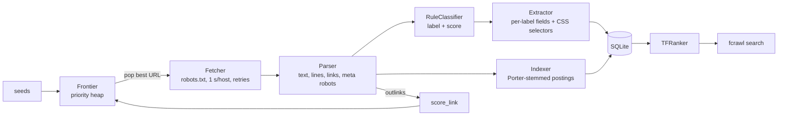
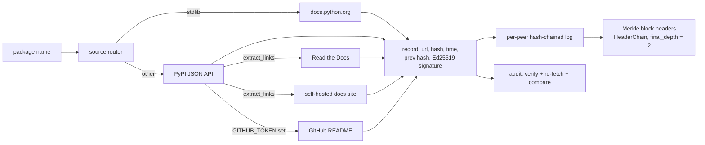
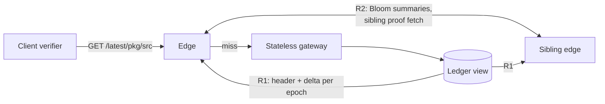

# Architecture

The project has three Python packages under `src/`. They share tooling but not code:
`edge_serving` builds on `crawl_ledger`, and `focused_crawler` is independent.

| Package | Milestone | Role |
|---|---|---|
| `focused_crawler` | M1 | Focused crawler and search engine for one university domain |
| `crawl_ledger` | M2/M3 | Decentralized Python-docs crawler whose records are signed, chained and audited |
| `edge_serving` | M4 | Edge caching and revocation for verified crawl records |

---

## 1. `focused_crawler` (M1): academic-domain focused crawler

Crawls a single registered domain (default `gatech.edu` and all its subdomains), labels each page
`COURSE`, `FACULTY`, `LAB` or `OTHER`, extracts structured fields and serves ranked search.

| Module | Responsibility |
|---|---|
| `config.py` | Loads `config/default.yaml` into dataclasses and validates it |
| `url_utils.py` | URL normalization (drops fragments, tracking and session params), scope check |
| `fetcher.py` | Polite HTTP: robots.txt cache, per-host delay, identifying User-Agent, retries on 429/5xx, HTML only |
| `frontier.py` | `heapq` priority queue with FIFO tie-break, seen set, depth limit, per-host cap |
| `parser.py` | BeautifulSoup + lxml: title, headings, block-level `lines`, links with anchor text and context, `noindex`/`nofollow` |
| `classifier.py` | URL-path and on-page cue rules, course-code regex (`CS 6675`), link scoring for the frontier |
| `extractor.py` | Fields per label (course: code, title, instructor, credit hours; faculty: name, position, department, email, research keywords; lab: name, PI, department) plus config selectors (`css` or `css@attr`) |
| `storage.py` | Tables `pages`, `links`, `courses`, `faculty`, `labs`, `postings`; exact duplicates via `content_hash` |
| `indexer.py` | Tokenizer with Porter stemming; also emits joined course codes (`cs6675`) |
| `ranker.py` | Baseline TF-IDF: `sum((1 + log tf) * log(1 + N/df)) / sqrt(doc_length)` |
| `crawler.py` | Main loop: budgets, per-page error isolation, commits every 20 pages, `CrawlStats` |
| `cli.py` | `fcrawl crawl / search / stats / export` |

**Crawl loop.** Pop the highest-scoring URL → skip if it is out of scope, too deep, over the host cap or
disallowed by robots → fetch → parse → classify → extract and store → index (unless `noindex`) →
score and push outlinks (unless `nofollow`). Each page is handled in its own `try`, so one bad page
never stops the crawl.

---

## 2. `crawl_ledger` (M2/M3): verifiable crowdsourced crawling

Peers on a Chord-style ring each crawl the packages they own and publish a signed record for each
page. Other peers audit records by re-fetching the page.

| Module | M3 component |
|---|---|
| `fetcher.py` | Source router, polite downloader, link extractor (RTD, self-hosted docs, GitHub) |
| `record.py`, `peer.py` | Record builder and Ed25519 signer, hash-chained log; node ID = hash(public key + address) |
| `ring.py` | Package ownership = successor of hash(name); successor lists for auditors |
| `verify.py` | Record ID, signature and chain checks; R1 Merkle-branch verification |
| `merkle.py`, `blocks.py` | Merkle roots and branches, block headers, `HeaderChain` with finality |
| `audit.py` | `PASS` if the hash matches, `INCONCLUSIVE` if the source signals a change (newest PyPI upload or `Last-Modified`), else `FAIL` |
| `r2.py` | Deterministic auditor selection, verdict settlement, reputation |
| `sim.py` | Live (or `--offline`) baseline run: crawl, verify, audit, metrics |
| `sim_m3.py` | Synthetic comparison of baseline vs R1 (blocks) vs R2 (audits + reputation) vs both |

Dishonest peers publish the hash of altered content for a share of their records (`--forge-rate`).
The forged flag is kept only as ground truth, so detection can be measured.

**Header extension for M4.** `Header` has an optional `delta_root`. It enters the header ID only when
set, so M3 header IDs and tests are unchanged.

---

## 3. `edge_serving` (M4): serving verified records from edges

Clients read crawl records through edge caches. They should not have to trust the edge, and a revoked
record should stop being accepted quickly.

### Served objects

| Object | Path | Cache rule | Contents |
|---|---|---|---|
| Proof | `/proof/{record_id}` | `max-age=31536000, immutable` | Signed record, Merkle branch, block header |
| Status | `/status/{record_id}` | `s-maxage=T_status` | Audit state (`INCLUDED`, `PASS`, `FAIL`, ...), epoch, gateway signature |
| Pointer | `/latest/{pkg}/{source}` | `s-maxage=T_ptr` | Current record ID for a package/source; the edge returns pointer + proof + status in one round trip |

### Components

| Module | Responsibility |
|---|---|
| `objects.py` | Proof/Status/Pointer/Response types and Cache-Control rules |
| `ledger_view.py` | Ledger: submit, `seal_epoch` (builds the `Delta` and `delta_root`), audits, finality, `build_demo_ledger` |
| `gateway.py` | Stateless origin; signs statuses |
| `edge.py` | LRU proof cache, metadata cache honoring `s-maxage`, `get_latest` |
| `client.py` | `VERIFY_RECORD` + gateway signature + `max_lag`. IDE policy accepts `{INCLUDED, PASS}` with `max_lag` 3; RAG policy accepts `{PASS}` with `max_lag` 1 |
| `delta.py`, `revocation.py` | **R1**: per-epoch status deltas committed by `delta_root`. Edges apply gossiped headers, fetch gaps and fall back to TTLs. Statuses are checked by Merkle branch; `INCLUDED` is implied once the proof's block is final |
| `summary.py` | **R2**: Kirsch–Mitzenmacher Bloom-filter summaries of cached proofs; fetch from a sibling, verify, else fall back to the gateway |
| `http_app.py` | aiohttp gateway and edge servers; concurrent misses for one path share a single upstream fetch |
| `sim.py` | Trace-driven simulation: Zipf reads, epochs, releases, revocations, gossip delay, modeled latency |

### Security checks (all covered by tests)

Each of these is rejected, refetched or sent back to the gateway:
- a tampered proof
- a tampered or misattributed status
- a forged or dropped delta entry (`delta_root` mismatch)
- a forged sibling copy
- an implied-`INCLUDED` claim on a non-final block
- a status older than `max_lag`

**Known limit:** an R1 edge reports its own `synced_epoch`, and a dishonest edge could misstate it
(M4 Section 3.1). The simulation has only honest edges.
